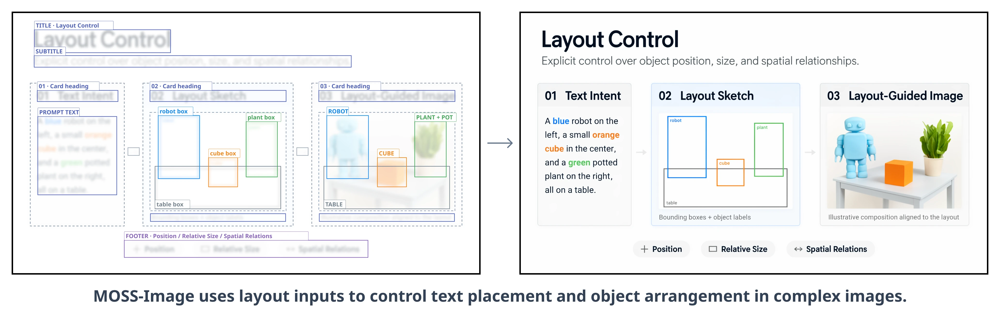

<div align="center">
  <p>
    
    
  </p>
  <p>
    <a href="https://huggingface.co/OpenMOSS-Team/MOSS-Image-Base"></a>
    &nbsp;
    <a href="https://huggingface.co/OpenMOSS-Team/MOSS-Image-SFT"></a>
    &nbsp;
    <a href="https://modelscope.cn/models/openmoss/MOSS-Image-Base"></a>
    &nbsp;
    <a href="https://modelscope.cn/models/openmoss/MOSS-Image-SFT"></a>
    &nbsp;
    <a href="https://huggingface.co/spaces/OpenMOSS-Team/MOSS-Image"></a>
    &nbsp;
    <a href="https://platform.mosi.cn/?utm_source=github&amp;utm_medium=readme&amp;utm_campaign=imageapi"></a>
    &nbsp;
    <a href="https://openmoss.github.io/MOSS-Image/"></a>
    &nbsp;
    <a href="paper/MOSS_Image_Technical_Report.pdf"></a>
    &nbsp;
    <a href="https://arxiv.org/abs/2610.23374"></a>
    &nbsp;
    <a href="https://x.com/Open_MOSS"></a>
    &nbsp;
    <a href="https://qm.qq.com/q/hphM7VhaDu"></a>
    &nbsp;
    <a href="https://applink.feishu.cn/client/chat/chatter/add_by_link?link_token=7a3m2007-815f-409b-9c3d-a4129f5c058e"></a>
    &nbsp;
    <a href="https://discord.gg/nXFWEyvbb"></a>
  </p>
  <p>
    <a href="README.md">English</a> &nbsp; | &nbsp; <strong>简体中文</strong>
  </p>
</div>

<a id="news"></a>

## 动态

- **[2026-10-20]** 🚀 **MOSS-Image** 系列现已上线 [MOSI API Platform](https://platform.mosi.cn/?utm_source=github&utm_medium=readme&utm_campaign=imageapi)，支持在 Playground 在线体验或通过 API 接入。

- **[2026-10-19]** 📄 [MOSS-Image 技术报告](https://arxiv.org/abs/2610.23374)已在 arXiv 公开。如果我们的工作对你有帮助，欢迎在 [Hugging Face Papers 上为我们点赞（upvote）](https://huggingface.co/papers/2610.23374)，感谢支持！🤗

- **[2026-10-18]** 🛠️ [KohakuMossTrainer](https://github.com/KohakuBlueleaf/KohakuMossTrainer) 已发布，支持 **MOSS-Image-Base** 和 **MOSS-Image-SFT** 的全参数微调与 LyCORIS 训练（包括 LoRA）。它提供丰富的优化器、混合精度训练（BF16/FP16/FP8/MXFP8/INT8）、多 GPU 训练（DDP/FSDP/流水线并行）、优化算子及 CPU 卸载，适配器训练最低可使用 **6GB 显存**。支持 Windows、Linux、NVIDIA GPU（SM70–SM120）和 Intel Arc GPU。详见 [GitHub 仓库](https://github.com/KohakuBlueleaf/KohakuMossTrainer)。

- **[2026-10-16]** 🚀 [SGLang](https://docs.sglang.io/cookbook/diffusion/OpenMOSS/MOSS-Image)、[vLLM-Omni](https://recipes.vllm.ai/OpenMOSS-Team/MOSS-Image-Base) 和 [ComfyUI](https://huggingface.co/Comfy-Org/MOSS-Image) 均已提供 MOSS-Image 的发布首日（Day-0）支持。

- **[2026-10-16]** 🎉 **MOSS-Image-Base** 和 **MOSS-Image-SFT** 正式发布！代码和模型权重已开放。

  **核心特点：**

  - 📐 **布局控制：** 控制文字与视觉元素的位置。
  - ✍️ **文字渲染：** 在图像中生成清晰、准确的文字。
  - 📜 **长提示词支持：** 支持最长 4K tokens 的文本提示词。
  - 🎨 **多样视觉风格：** 生成高质量的动漫风格与照片级写实图像。
  - 🛠️ **易于微调：** 将基础模型适配到自定义任务和领域。
  - ⚡ **紧凑高效：** 基于 5B 主干网络，实现高效图像生成。
  - 🖥️ **异构 GPU 训练：** 采用替代 GPU 平台训练。

<a id="community-projects"></a>

## 社区项目

- [DiffSynth-Studio](https://github.com/modelscope/DiffSynth-Studio) 现已支持 **MOSS-Image-Base** 和 **MOSS-Image-SFT** 的全参数微调与 LoRA 训练！详见[训练文档](https://github.com/modelscope/DiffSynth-Studio/blob/main/docs/zh/Model_Details/MOSS-Image.md)和[示例脚本](https://github.com/modelscope/DiffSynth-Studio/tree/main/examples/moss_image/model_training)。

- **MATLOWAI** 的 [MOSS-Image-SFT-DeBand](https://huggingface.co/MATLOWAI/MOSS-Image-SFT-DeBand) 提供用于减少 **MOSS-Image-SFT** 垂直色带的社区 LoRA，以及 ComfyUI 预设工作流。示例、参数及色带抑制与图像细节变化之间的取舍，详见模型卡。

- **lodestones** 的 [MOSS-Image-SFT-8-steps-dmd](https://huggingface.co/lodestones/MOSS-Image-SFT-8-steps-dmd) 是基于 **MOSS-Image-SFT** 的社区 8 步 DMD 蒸馏项目，提供可用于 ComfyUI 的 LoRA 适配器。最新权重及使用建议详见模型卡。

- **KBlueLeaf** 的 [MOSS-Image-FP16-fixed](https://huggingface.co/KBlueLeaf/MOSS-Image-FP16-fixed) 提供适用于 FP16 推理的 **MOSS-Image-Base** 和 **MOSS-Image-SFT** Transformer 权重，通过残差流缩放增加数值溢出余量。提供 Diffusers 和 ComfyUI 格式，加载方式及适配器兼容性详见模型卡。

- **Rkkss** 的 [ComfyUI-Spectrum-MOSS](https://github.com/Rkkss/ComfyUI-Spectrum-MOSS) 通过 Spectrum 风格的隐藏状态预测加速 ComfyUI 中的 MOSS-Image 采样，提供手动配置节点和实验性自适应节点。推荐采样设置及示例详见仓库。

<a id="user-guide"></a>

## 用户指南

推荐推理参数、提示词示例、布局输入格式和 LoRA 训练建议，见
**[中文用户指南](USERGUIDE_ZH.md)** 或 **[English user guide](USERGUIDE.md)**。

<a id="comfyui"></a>

## ComfyUI

MOSS-Image 已获 [ComfyUI 官方原生支持](https://github.com/Comfy-Org/ComfyUI/pull/17095)。更新至包含该支持的 ComfyUI master/nightly 并安装依赖后，可使用内置加载节点和 [ComfyUI 格式权重](https://huggingface.co/Comfy-Org/MOSS-Image)，无需额外安装 MOSS-Image 插件。

本仓库插件仍可用于直接加载本地 Hugging Face / Diffusers 模型目录，以及运行已有插件工作流。

[安装与使用](comfyui/README_ZH.md) · [HF 加载插件工作流](comfyui/moss-image/example_workflows/moss-image.json)

<a id="prompt-enhancer"></a>

## 提示词增强 Skill

[MOSS-Image Prompt Enhancer](skills/moss-image-prompt-enhancer/SKILL.md) 可将图像想法
扩写为详细 caption 或空间 Layout 提示词，面向具备本地文件和 Python 工具的 GPT-6
系列代理设计。随附脚本将像素坐标草稿转换为紧凑 JSON 和整数中心坐标，不调用图像生成服务。

将 [skill 目录](skills/moss-image-prompt-enhancer) 安装到代理的技能目录后，使用
`$moss-image-prompt-enhancer`，提供图像需求、caption 或 Layout 输出要求，以及画布尺寸。
将编译结果粘贴到 MOSS-Image 的正向提示词中；使用 Layout 时，生成尺寸应与草稿一致。


## 目录

- [动态](#news)
- [社区项目](#community-projects)
- [用户指南](#user-guide)
- [ComfyUI](#comfyui)
- [提示词增强 Skill](#prompt-enhancer)
- [模型](#models)
- [快速开始](#quick-start)
  - [安装](#installation)
  - [Python](#python)
  - [Gradio](#gradio)
  - [采样参数](#sampling-settings)
  - [显存与性能](#memory-and-performance)
- [Layout 布局生成](#layout-generation)
- [Showcase](#showcase)
- [引用](#citation)
- [许可与致谢](#license)
- [Star History](#star-history)

<a id="models"></a>

## 🤗 模型

| 模型 | 说明 |
| --- | --- |
| [MOSS-Image-Base](https://huggingface.co/OpenMOSS-Team/MOSS-Image-Base) · [ModelScope](https://modelscope.cn/models/openmoss/MOSS-Image-Base) | 基础文生图模型 |
| [MOSS-Image-SFT](https://huggingface.co/OpenMOSS-Team/MOSS-Image-SFT) · [ModelScope](https://modelscope.cn/models/openmoss/MOSS-Image-SFT) | 在精选数据上对 MOSS-Image-Base 微调得到的模型 |

### Base 与 SFT 对比

在这个例子中，SFT 的文字分组更清晰，白板内容的排版更有条理。

| MOSS-Image-Base | MOSS-Image-SFT |
| --- | --- |
|  |  |

<!-- MOSS-Image-Base 使用 42 层扩散 Transformer、Qwen3.5-9B 文本编码器和 FLUX.2 VAE。 -->

<a id="quick-start"></a>

## 🚀 快速开始

<a id="installation"></a>

### 🛠️ 安装

```bash
git clone https://github.com/OpenMOSS/MOSS-Image.git
cd MOSS-Image
python -m venv .venv
source .venv/bin/activate

pip install -r requirements.txt
```

<a id="python"></a>

### 🐍 Python

```python
import torch
from diffusers import DiffusionPipeline

pipe = DiffusionPipeline.from_pretrained(
    "OpenMOSS-Team/MOSS-Image-Base",
    custom_pipeline="pipeline_moss_image",
    trust_remote_code=True,
    torch_dtype={"default": torch.bfloat16, "vae": torch.float32},
)
pipe.scheduler = type(pipe.scheduler).from_config(pipe.scheduler.config)
pipe.to("cuda")
image = pipe(
    "A wide view of a refrigerator beside a kitchen counter with a fruit bowl. A small sticky note on the refrigerator door is handwritten in Chinese:“\n记得买牛奶和鸡蛋！\n牛奶两盒，鸡蛋一打。\n顺便带一袋面包。”",
    height=1456,
    width=1456,
    num_inference_steps=50,
    guidance_scale=3.0,
    uncond_skip_layers=[22],
    generator=torch.Generator("cpu").manual_seed(42),
).images[0]
image.save("refrigerator_note.png")
```

<a id="gradio"></a>

### 🎨 Gradio

```bash
pip install -e '.[ui]'
python gradio_app.py --model OpenMOSS-Team/MOSS-Image-Base
```

<a id="sampling-settings"></a>

### 🎛️ 采样参数

| 参数 | 默认值 |
| --- | --- |
| 采样器 | Flow-matching Euler |
| 步数 | 50 |
| CFG | 3 |
| Shift | 5 |
| 跳层 | 负向分支跳过第 22 层 |
| 负面提示词（Python API） | 空 |

采样与提示词建议见[用户指南](USERGUIDE_ZH.md)。

<a id="memory-and-performance"></a>

### ⚡ 显存与性能

在 Gradio 的高级设置中选择 Memory mode：

| 模式 | 行为 |
| --- | --- |
| GPU resident | 全模型驻留 GPU |
| Component | 按需在 CPU 与 GPU 之间移动模型组件 |
| Sequential · fallback | 更低显存占用，推理速度较慢 |
| Low memory | DiT 权重保留在 CPU 内存，文本编码器和 VAE 权重从磁盘按需加载 |

显存不足时，选择 Sequential 或减小图像尺寸。
需要降低显存和系统内存占用时，可选择 `minimal` 档位（Low memory 模式）：

```bash
python gradio_app.py --profile minimal --model OpenMOSS-Team/MOSS-Image-Base
```

`auto` 档位在 GPU 预算低于 12 GiB 时选择 `minimal`。建议将模型文件放在 SSD 上：
DiT 权重保留在 CPU 内存，文本编码器和 VAE 权重按需加载。

实测峰值（单张 1024×1024 图片，50 步）：

| 资源 | 峰值占用 |
| --- | --- |
| PyTorch 显存分配 / 保留 | 3.65 / 3.85 GiB |
| 任务系统内存，含文件缓存 | 14.00 GiB |

Compile DiT 默认关闭，Sequential 和 Low memory 模式下不可用。

<a id="layout-generation"></a>

## 📐 Layout 布局生成

MOSS-Image 通过 JSON layout 输入控制复杂画面中的文字排版与物体布局，下图即为
MOSS-Image 使用布局控制生成的结果。

基于 layout，我们还可以实现受控编辑、用户友好的排版工具等应用。
通过修改文字、元素描述和边界框，用户可以结构化地调整画面内容与布局。

[](assets/showcase/layout-bboxes.svg)

将布局 JSON 粘贴到 Gradio 的 Prompt 输入框，即可指定场景、文字、物体及其位置。
下面使用 `summary`/`items` 格式，以 **1024×1024** 画布为例，将内容保存为 `layout.json`：

```json
{
  "summary": {
    "meta": ["poster"],
    "canvas": "single",
    "caption": "A minimalist travel poster with a cream background, a blue mountain illustration, and the title EXPLORE at the top."
  },
  "items": [
    {
      "label": "text",
      "caption": "Large dark-blue uppercase title centered at the top.",
      "text": "EXPLORE",
      "bbox": [-416, -384, -288, 384]
    },
    {
      "label": "object",
      "caption": "A flat blue mountain illustration in the lower center.",
      "bbox": [-192, -288, 384, 288]
    }
  ],
  "bbox_coord_space": "abs_centralized",
  "bbox_format": "yxyx"
}
```

- `summary.caption`：整体场景与风格描述。
- `items`：各元素的 `label`、`caption` 和 `bbox`；需要生成文字时使用 `text` 指定内容。
- `bbox_format: "yxyx"`：框坐标顺序为 `[y_min, x_min, y_max, x_max]`。
- `bbox_coord_space: "abs_centralized"`：以画布中心为原点的像素坐标。
  对于 1024×1024 画布，两轴范围均为 −512 到 +512，x 向右、y 向下递增。
  对于宽 W、高 H 的画布，将常规左上角原点的 x 坐标减去 W/2、y 坐标减去 H/2 即可转换。

框坐标应与指定的输出尺寸一致。在 Gradio 中，将 JSON 粘贴到提示词输入框，
并设置对应的宽高；使用 Python API 时，将 `json.dumps(layout, ensure_ascii=False)`
作为提示词字符串传入。

<a id="showcase"></a>

## 🖼️ Showcase


<a id="citation"></a>

## 📝 引用

如果你在研究中使用 MOSS-Image，请引用我们的技术报告：

```bibtex
@misc{ai2026mossimagetechnicalreport,
      title={MOSS-Image Technical Report},
      author={MOSI. AI},
      year={2026},
      eprint={2610.23374},
      archivePrefix={arXiv},
      primaryClass={cs.CV},
      url={https://arxiv.org/abs/2610.23374},
}
```

<a id="license"></a>

## 📄 许可与致谢

推理代码采用 [Apache License 2.0](LICENSE)。

感谢 Diffusers、Qwen 和 FLUX 团队。

<a id="star-history"></a>

## ⭐ Star History

<a href="https://www.star-history.com/?repos=OpenMOSS%2FMOSS-Image&amp;type=date">
  <picture>
    <source media="(prefers-color-scheme: dark)" srcset="https://api.star-history.com/chart?repos=OpenMOSS/MOSS-Image&amp;type=date&amp;theme=dark" />
    <source media="(prefers-color-scheme: light)" srcset="https://api.star-history.com/chart?repos=OpenMOSS/MOSS-Image&amp;type=date" />
    
  </picture>
</a>
